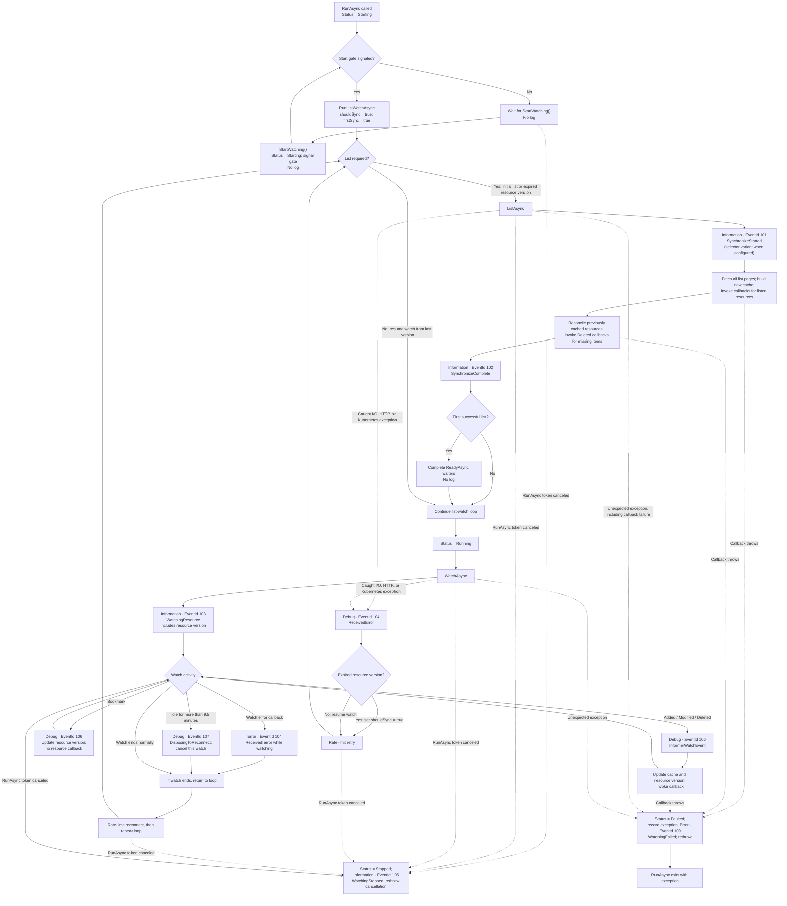
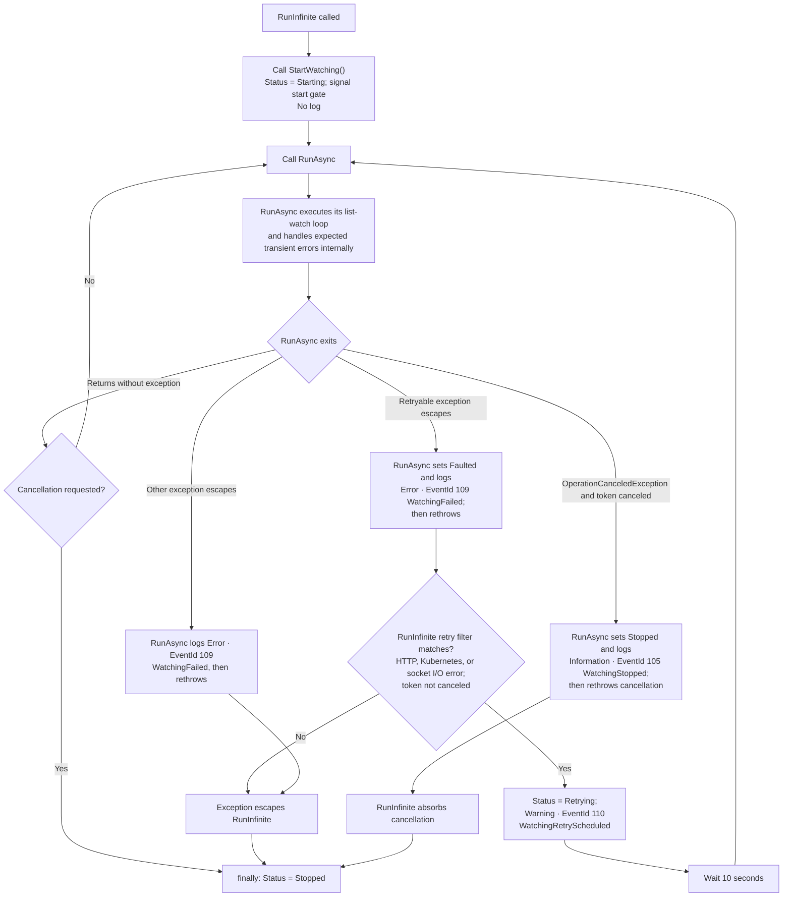

# Resource informer lifecycle and logs

These diagrams cover `ResourceInformer<TResource>` itself. They do not include host startup or hosted-service adapter logs.

## `RunAsync`

`RunAsync` waits for `StartWatching()` before making API requests. The initial list completes before `ReadyAsync()` is signaled. Recoverable list/watch errors are handled inside the list-watch loop and do not normally change the status to `Retrying`.

## `RunInfinite`

`RunInfinite` is a wrapper around repeated `RunAsync` calls. It calls `StartWatching()` itself. Most expected API/watch failures are retried inside `RunAsync`; the 10-second warning-and-delay path below applies when a retryable exception escapes that inner loop.

## Log levels and operational criticality

| Level | Event | Interpretation |
|---|---|---|
| **Debug — diagnostic** | 106 `InformerWatchEvent` | Per-watch-event detail; potentially high volume. Initial-list items invoke callbacks but are not individually logged by the informer. |
| **Debug — usually recoverable** | 104 `ReceivedError` | A caught I/O, HTTP, or Kubernetes exception. The list-watch loop rate-limits and retries. |
| **Debug — expected recovery** | 107 `DisposingToReconnect` | The watch has been idle for over 9.5 minutes and is deliberately closed to trigger reconnection. |
| **Information — normal** | 101 `SynchronizeStarted`; 102 `SynchronizeComplete` | A list or relist starts and completes. |
| **Information — normal** | 103 `WatchingResource` | A watch opens; emitted again after reconnects. |
| **Information — normal stop** | 105 `WatchingStopped` | `RunAsync` observed cancellation from its supplied token. |
| **Warning — retry scheduled** | 110 `WatchingRetryScheduled` | `RunInfinite` will wait 10 seconds before retrying an escaping retryable exception. |
| **Error — may still recover** | 104 `ReceivedError` | The watch error callback reported an error. This log alone does not mean the informer stopped. The same event ID is also used at Debug level for caught loop errors. |
| **Error — failed run** | 109 `WatchingFailed` | An exception escaped `RunAsync`; its status becomes `Faulted` and the exception is rethrown. `RunInfinite` may retry matching exceptions. |

There are no Critical-level logs in `ResourceInformer<TResource>`. `StartWatching()`, callback invocation, and `ReadyAsync()` do not log directly.
