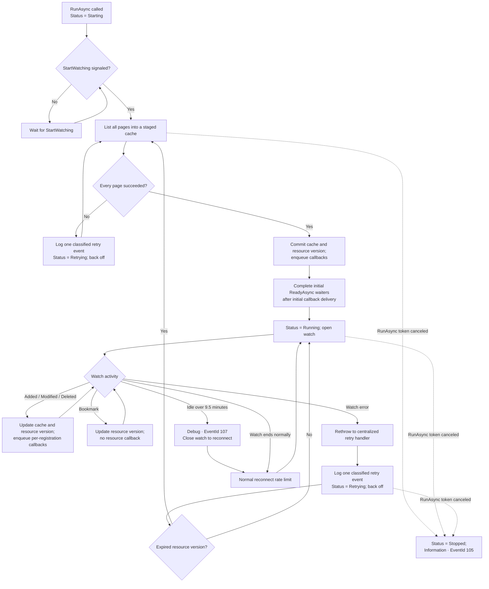
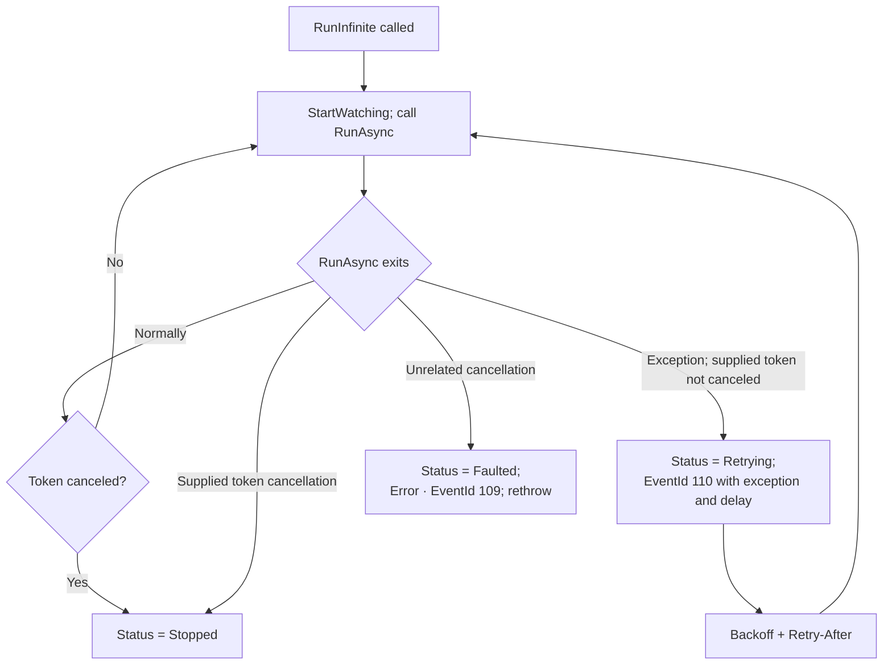

# Resource informer lifecycle and logs

These diagrams describe `ResourceInformer<TResource>` only; they exclude host startup and hosted-service adapter logs.

## `RunAsync`

`RunAsync` waits for `StartWatching()` before requesting resources. It publishes the initial cache and completes `ReadyAsync()` only after every list page succeeds and initial callbacks finish. A failed page publishes neither partial cache contents nor callbacks; the whole list is retried. HTTP and Kubernetes status failures are retried regardless of status code. Resource-version expiry triggers a relist. Retry delays use bounded exponential backoff with jitter and honor Kubernetes `Retry-After` where available. A watch lasting at least one minute is considered sustained and resets the consecutive retry backoff if it then fails; normal watch completion also resets it.

## `RunInfinite`

`RunInfinite` calls `StartWatching()` and repeatedly invokes `RunAsync`. List/watch exceptions are normally retried inside `RunAsync`; any non-cancellation exception that escapes is logged once with EventId 110 and retried with bounded backoff. The retry log uses the same severity classifier as list/watch failures. Cancellation by the supplied token stops the informer; an unrelated `OperationCanceledException` is treated as a fault and escapes.

## Registrations and callbacks

Registrations can be added at any time. A registration added before the initial cache is committed participates in the initial delivery. A later registration asynchronously replays the current cache as `Added`, followed by subsequent events. Each registration has an asynchronous single-reader queue, preserving its event order; registrations may run concurrently. `ReadyAsync()` waits for initial delivery or late-cache replay. A callback exception is logged with Error and EventId 111, then only that registration is removed; it does not fault the informer. Relist-generated deletions carry the last full object observed by the informer.

## Log levels and operational criticality

List and watch request failures share EventId 104 (`ReceivedError`). The watch-stream error callback rethrows into the central handler, so one failure produces one retry log. The exception is attached to the log and the selected retry delay is included as structured context. Status failures continue to retry; severity does not change retry behavior.

| Level | Event | Operational meaning |
|---|---|---|
| **Debug** | 106 `InformerWatchEvent` | Per-event detail; potentially high volume. Initial-list resources are not logged individually. |
| **Debug** | 107 `DisposingToReconnect` | Expected reconnect after an idle watch exceeds 9.5 minutes. |
| **Information** | 101 `SynchronizeStarted`; 102 `SynchronizeComplete` | Normal list/relist lifecycle. |
| **Information** | 103 `WatchingResource` | A watch opens, including after reconnect. |
| **Information** | 104 `ReceivedError` for 410 / expired resource version | Expected recovery; the informer backs off and performs a full relist. |
| **Information** | 105 `WatchingStopped` | `RunAsync` observed cancellation from its supplied token. |
| **Warning** | 104 `ReceivedError` for transport errors, timeouts, 429, or 5xx | Transient failure is being retried; exception and retry delay are included. |
| **Error** | 104 `ReceivedError` for other 4xx or unexpected failures | Actionable or unexpected failure; it is still retried by the current list/watch contract. |
| **Warning / Error / Information** | 110 `WatchingRetryScheduled` | `RunInfinite` retries an exception that escaped `RunAsync`; severity reflects the same failure classification. |
| **Error** | 109 `WatchingFailed` | `RunAsync` exits faulted. This is suppressed inside `RunInfinite` when EventId 110 will report and retry the exception. |
| **Error** | 111 `CallbackFailed` | One event callback failed; only that registration is removed. |

There are no Critical-level logs in `ResourceInformer<TResource>`. `StartWatching()` and `ReadyAsync()` do not log directly.
